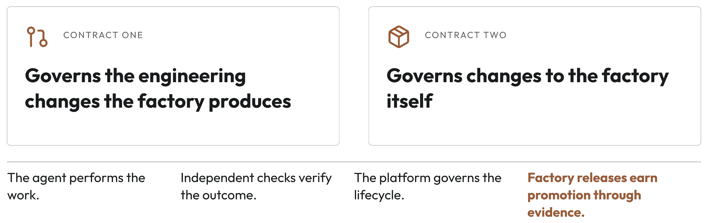
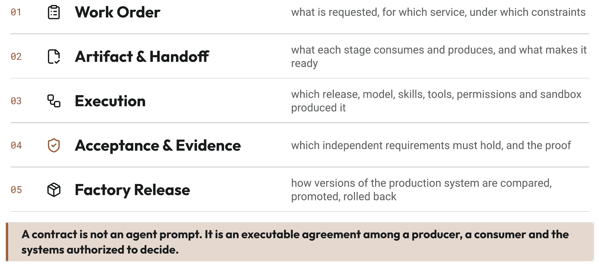
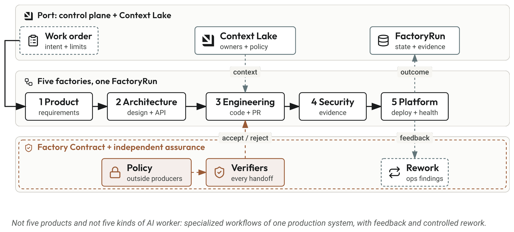
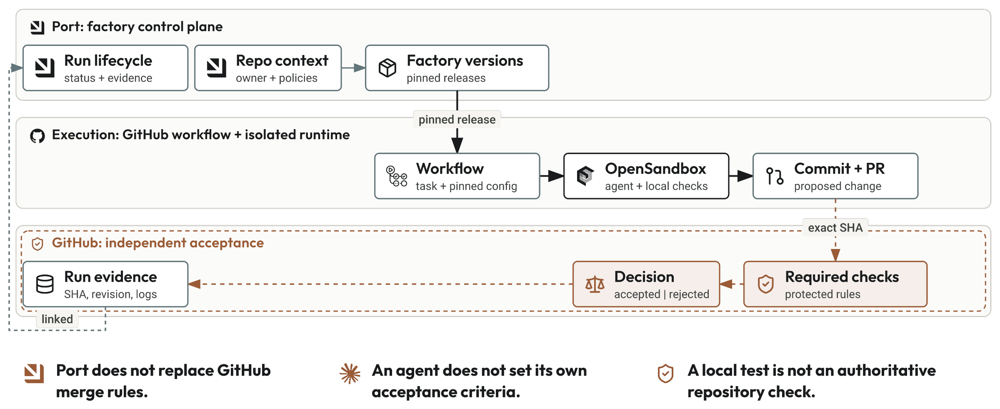
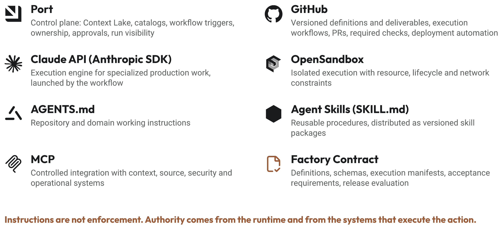
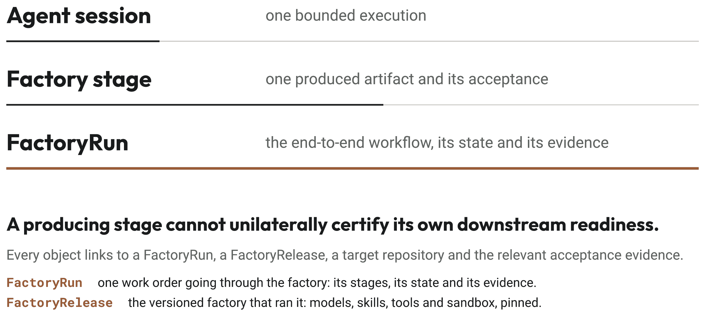
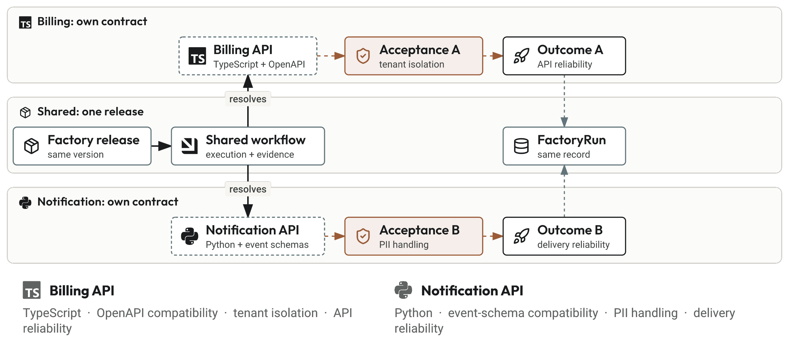
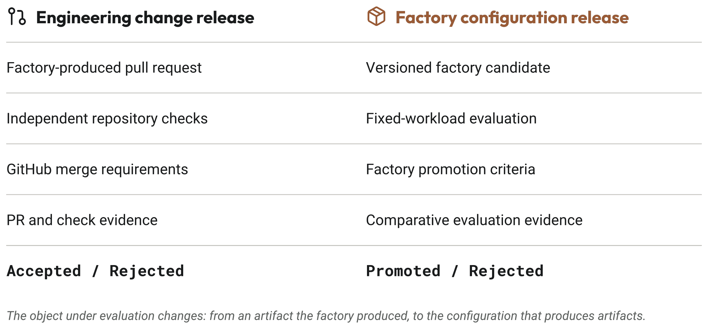
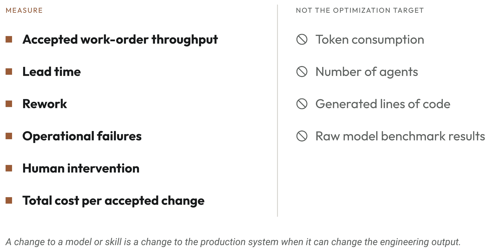
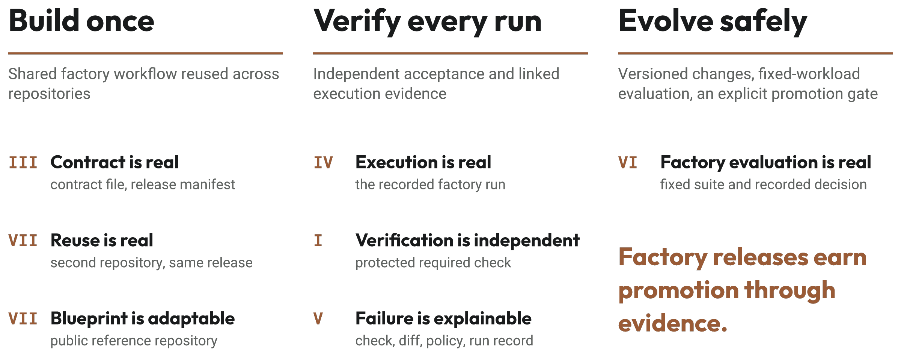

# AI Software Factory Contract

[](LICENSE)
[](factory-releases/1.4.0/factory-release.yaml)
[](https://github.com/Darshitpandya/ai-software-factory-contract/actions/workflows/verify-repo.yml)
[](factory-releases/skills.lock.json)
[](docs/models.md)
[](https://app.getport.io)

**Build Once · Verify Every Run · Evolve Safely**

A production-oriented engineering factory: a `WorkOrder` moves through five specialised stages, each producing independently verified artifacts, until a trusted verifier the producer cannot control either accepts or blocks the final handoff.

[Get started](#quick-start) · [Architecture](#architecture) · [Commands](#commands-reference) · [Port setup](#port-setup) · [Adopt this](#adopter-guide) · [Contributing](CONTRIBUTING.md) · [Models](docs/models.md)

---

## What this is

<picture>
  <source media="(prefers-color-scheme: dark)" srcset="docs/diagrams/s07-two-release-contracts-dark.png">
  
</picture>

Two independent contracts govern the system. Contract One controls what the factory produces — engineering changes, artifacts, PRs. Contract Two controls the factory itself — model selection, skill versions, evaluation, promotion. Neither contract can satisfy the other's acceptance requirements.

<picture>
  <source media="(prefers-color-scheme: dark)" srcset="docs/diagrams/s19-five-interfaces-dark.png">
  
</picture>

Five interfaces define the boundary at every handoff: **WorkOrder**, **Artifact & Handoff**, **Execution**, **Acceptance & Evidence**, **FactoryRelease**. A contract is not a prompt. It is an executable agreement among a producer, a consumer, and the systems authorised to decide.

---

## Architecture

<picture>
  <source media="(prefers-color-scheme: dark)" srcset="docs/diagrams/s09-five-factories-pipeline-dark.png">
  
</picture>

<picture>
  <source media="(prefers-color-scheme: dark)" srcset="docs/diagrams/s14-three-authorities-dark.png">
  
</picture>

Port does not replace GitHub merge rules. An agent does not set its own acceptance criteria. A local test is not an authoritative repository check. In this reference implementation the coordinator runs on a workstation; in production it is a deployed service.

<picture>
  <source media="(prefers-color-scheme: dark)" srcset="docs/diagrams/s15-tool-ecosystem-dark.png">
  
</picture>

<picture>
  <source media="(prefers-color-scheme: dark)" srcset="docs/diagrams/s11-factoryrun-hierarchy-dark.png">
  
</picture>

A producing stage cannot unilaterally certify its own downstream readiness. Every object links to a FactoryRun, a FactoryRelease, a target repository, and the relevant acceptance record.

### Component map

```
packages/
  contract-types/     TypeScript interfaces for all factory records
  port-client/        Port API: token renewal, entity upsert, action run reporting
  github-client/      GitHub App: file reads + PR creation (producer App, scoped)
  state-machine/      PostgreSQL-backed stages, leases, idempotency, retries
  claude-executor/    Anthropic SDK agentic loop; loads AGENTS.md + SKILL.md per stage
  sandbox-adapter/    Local temp dirs (dev) or OpenSandbox API (CI/hardened)
  artifact-store/     SHA-256 bundle collection and evidence persistence
  acceptance-client/  Polls GitHub Checks API for factory-contract/acceptance verdict

apps/
  factory-cli/          CLI: doctor, run, resume, evaluate, promote, port:apply, teardown
  factory-coordinator/  Stateful coordinator worker; PostgreSQL leases, outbox, retries

factories/
  product-requirements/   AGENTS.md, 3×SKILL.md, acceptance.yaml, verify script
  software-architecture/  AGENTS.md, 3×SKILL.md, acceptance.yaml, verify script
  software-engineering/   AGENTS.md, 3×SKILL.md, acceptance.yaml, verify script
  security-compliance/    AGENTS.md, 3×SKILL.md, acceptance.yaml, verify script
  platform-operations/    AGENTS.md, 3×SKILL.md, acceptance.yaml, verify script

factory-releases/
  1.4.0/factory-release.yaml   ACTIVE — per-stage model assignments + sandbox config
  1.5.0/factory-release.yaml   CANDIDATE — arch + eng use claude-fable-5-2
  active.yaml                  Protected pointer; update only via pnpm factory promote
  skills.lock.json             Real SHA-256 digests for all 15 skills
```

---

## The Four Repositories

<picture>
  <source media="(prefers-color-scheme: dark)" srcset="docs/diagrams/s46-reuse-across-repositories-dark.png">
  
</picture>

| Repo | Role |
|------|------|
| **This repo** | Factory engine — contracts, coordinator, executor, 5 stages, evaluation, CLI |
| [`ai-factory-trusted-verifier`](https://github.com/Darshitpandya/ai-factory-trusted-verifier) | Independently owned verifier — GitHub App, oasdiff, protected policies |
| [`factory-reference-billing-api`](https://github.com/Darshitpandya/factory-reference-billing-api) | TypeScript consumer — invoice export, the breaking-change demo |
| [`factory-reference-notification-api`](https://github.com/Darshitpandya/factory-reference-notification-api) | Python consumer — event schema, PII controls, reuse proof |

The trust boundary: the billing and notification repos require `factory-contract/acceptance` from the **verifier's GitHub App** — the producer App cannot satisfy it.

---

## Quick Start

**Prerequisites:** Node.js ≥ 22, pnpm ≥ 9, Docker, PostgreSQL, Port org, Anthropic API key.

```bash
git clone https://github.com/Darshitpandya/ai-software-factory-contract.git
cd ai-software-factory-contract
pnpm install
cp .env.example .env          # fill in PORT_*, ANTHROPIC_API_KEY, DATABASE_URL
docker compose -f infra/local/docker-compose.yaml up -d
pnpm bootstrap                 # migrations → skills.lock → Port entities → registry verify
pnpm factory doctor --profile local-dev
```

Start the coordinator (keeps running, picks up work orders automatically):

```bash
nohup node_modules/.bin/tsx apps/factory-coordinator/src/index.ts > /tmp/coordinator.log 2>&1 &
```

Trigger a factory run from Port (create a WorkOrder entity → click **▶ Trigger Factory Run**) or from the CLI:

```bash
pnpm factory run --work-order wo-billing-invoice-export-001 --release 1.4.0
```

---

## Commands Reference

```bash
# Health
pnpm factory doctor --profile local-dev

# Factory runs
pnpm factory run --work-order <id> --release 1.4.0
pnpm factory run --work-order <id> --release 1.4.0 --dry-run
pnpm factory resume --run-id <uuid>

# Port control plane
pnpm factory port:plan
pnpm factory port:apply

# Skills registry
pnpm factory registry:verify
pnpm lock-components

# Evaluation
pnpm factory evaluation:run --base 1.4.0 --candidate 1.5.0
pnpm factory evaluation:report --comparison <id>

# Promotion
pnpm factory promote --candidate 1.5.0 --decision <id>

# Evidence
pnpm factory evidence:verify --run-id <uuid>

# CI
pnpm typecheck && pnpm lint && pnpm test
```

---

## Factory Release Model Assignments

**Release 1.4.0 (ACTIVE)** — per-stage assignments, not a single model:

| Stage | Model | Rationale |
|-------|-------|-----------|
| `product-requirements` | `claude-sonnet-5-5` | Requirements: creative + structured |
| `software-architecture` | `claude-opus-5-5` | ADRs + OpenAPI: deep reasoning |
| `software-engineering` | `claude-opus-5-5` | Code + tests: long-horizon |
| `security-compliance` | `claude-sonnet-5-5` | Policy matching: fast + structured |
| `platform-operations` | `claude-haiku-5-5` | Health checks: fast + cheap |

Pricing: opus $15/$75 · sonnet $3/$15 · haiku $0.25/$1.25 per million tokens.
Typical cost per 5-stage run: **~$2.10**. See [docs/models.md](docs/models.md) for the full guide.

**Release 1.5.0 (CANDIDATE):**
```yaml
stageModels:
  software-architecture: claude-fable-5-2
  software-engineering:  claude-fable-5-2
  # other stages fall back to defaultModel: claude-opus-5-5
```

---

## Port Setup

Port is the control plane. Three steps for a fresh org:

**1. Blueprints — Terraform**
```bash
cd infra/terraform && cp terraform.tfvars.example terraform.tfvars
# Fill in: port_client_id, port_client_secret, github_token, github_owner
terraform init && terraform apply
```

**2. Pages — restore script**
```bash
export PORT_CLIENT_ID=... PORT_CLIENT_SECRET=...
python3 control-plane/port/apply-pages.py
```

**3. Data — backfill after runs**
```bash
python3 scripts/backfill-port-runs.py
```

### Blueprints

| Blueprint | Purpose |
|-----------|---------|
| `service` | A deployable service tracked by the factory |
| `workOrder` | A versioned engineering intent |
| `factoryRelease` | A pinned, locked factory configuration |
| `factoryRun` | End-to-end execution and evidence record |
| `promotionDecision` | Recorded promote / hold / reject decision |
| `factoryComponent` | Skill, MCP tool, sandbox image in the registry |
| `factorySkill` | Individual skill with SHA-256 digest |

### Self-service actions

| Action | Blueprint | Workflow |
|--------|-----------|---------|
| `createWorkOrder` | workOrder | `factory-run.yml` |
| `triggerFactoryRun` | workOrder | `factory-run.yml` |
| `resumeFactoryRun` | factoryRun | `factory-retry.yml` |
| `approveStage` | factoryRun | `factory-run.yml` |
| `cancelFactoryRun` | factoryRun | `factory-retry.yml` |
| `runFactoryEvaluation` | factoryRelease | `factory-eval.yml` |
| `promoteFactoryRelease` | factoryRelease | `factory-promote.yml` |

### Getting Port credentials

1. `app.getport.io` → Organization Settings → Credentials → create machine account
2. Copy `clientId` and `clientSecret`
3. Set as GitHub secrets `PORT_CLIENT_ID` and `PORT_CLIENT_SECRET`

---

## GitHub Apps Setup

Two Apps required for the independent acceptance boundary:

| App | Owned by | Permissions | Installs on |
|-----|---------|-------------|-------------|
| Producer App | This repo | `contents:read`, `pull_requests:write`, `actions:write` | Consumer repos |
| Verifier App | `ai-factory-trusted-verifier` | `contents:read`, `checks:write`, `pull_requests:read` | Consumer repos |

After install, set branch protection on consumer repos: add `factory-contract/acceptance` as a required check and **restrict its source to the Verifier App identity**.

See [`infra/github/`](infra/github/README.md) for setup scripts.

---

## Evolving the Factory

<picture>
  <source media="(prefers-color-scheme: dark)" srcset="docs/diagrams/s39-two-release-decisions-dark.png">
  
</picture>

<picture>
  <source media="(prefers-color-scheme: dark)" srcset="docs/diagrams/s44-factory-economics-dark.png">
  
</picture>

Measure accepted work-order throughput, lead time, rework rate, and cost per accepted change — not token consumption or lines of code generated.

---

## Adopter Guide

Using this factory for a **different repository**:

1. Add `.factory/repository-contract.yaml` (see `contracts/schemas/repository-contract.schema.json`)
2. Add `.factory/work-orders/your-feature.yaml` for each work order
3. Add `AGENTS.md` with factual workspace instructions (build commands, path boundaries, do-not-modify areas)
4. Install both GitHub Apps and configure branch protection with the verifier's `factory-contract/acceptance` check
5. Create a `service` entity in Port pointing to your repo

You do **not** copy any orchestration code. The factory runs against your repo remotely.

---

## What this proves

<picture>
  <source media="(prefers-color-scheme: dark)" srcset="docs/diagrams/s48-seven-proofs-dark.png">
  
</picture>

---

## Security

- No credential enters any committed file, PR, or agent prompt
- The trusted verifier runs in a separate repo under separate ownership
- Each stage's acceptance is set by the verifier or an authorised human — never by the stage executor
- `factory-releases/active.yaml` is updated only via `pnpm factory promote` after a valid `PromotionDecision`

See [SECURITY.md](SECURITY.md).

---

## Contributing

See [CONTRIBUTING.md](CONTRIBUTING.md).

---

## License

MIT — see [LICENSE](LICENSE). Your `WorkOrder` contents, `AGENTS.md`, and produced artifacts are yours.
