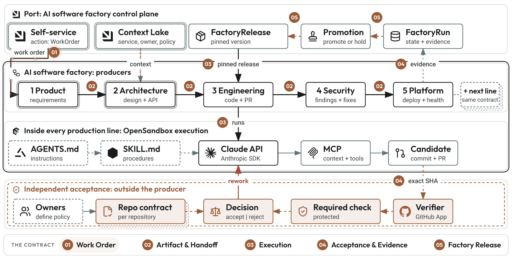

# control-plane/port

Port control plane definitions — blueprints, page layouts, and the restore script.

→ [Root README](../../README.md#port-setup) for the full setup sequence.

---

<picture>
  <source media="(prefers-color-scheme: dark)" srcset="../../docs/diagrams/s13-blueprint-dark.gif">
  
</picture>

> **Note:** This diagram shows GitHub Actions as the trigger. In this reference implementation the coordinator runs on a workstation. GitHub Actions creates the work order record; the coordinator processes it. In production the coordinator is a deployed persistent service.

---

## What is here

| Path | What it is |
|------|-----------|
| `pages/*.json` | Saved page layouts for all 12 dashboards and entity pages |
| `apply-pages.py` | Idempotent restore script — applies every page to a Port org |

The JSON files are the source of truth for the Port interface. If a page is accidentally edited in the UI, run the script to restore it.

## First time setup

Blueprints must exist before pages can be applied. Run Terraform first:

```bash
cd ../../infra/terraform
terraform apply
```

Then restore pages:

```bash
export PORT_CLIENT_ID=your-client-id
export PORT_CLIENT_SECRET=your-client-secret
python3 apply-pages.py
```

## To update pages

Edit a page in the Port UI, then export it back to this directory:

```bash
# From repo root
export PORT_CLIENT_ID=... PORT_CLIENT_SECRET=...
python3 scripts/export-port-pages.py   # or use apply-pages.py as reference
```

Commit the updated JSON so the change is reproducible.

## What you bring

Your own Port org credentials. These files contain no credentials and reference no specific Port org.
