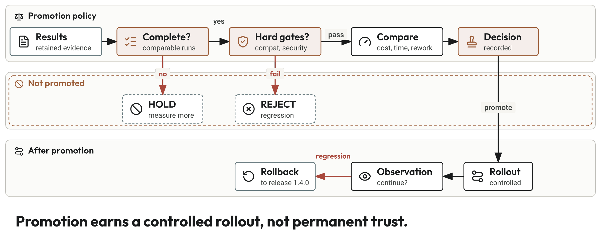

# evaluation

Fixed workload definitions and promotion policy for comparing factory releases.

→ [Root README](../README.md#evolving-the-factory) · [docs/models.md](../docs/models.md)

---

## How evaluation works

```bash
pnpm factory evaluation:run --base 1.4.0 --candidate 1.5.0
pnpm factory evaluation:report --comparison <comparison-id>
```

The coordinator runs each work order against both releases. Results are recorded in PostgreSQL and the Port `PromotionDecision` entity.

## Hard gates

| Gate | What it checks | Failure means |
|------|---------------|---------------|
| HG-001 | No breaking API change passes `factory-contract/acceptance` | Candidate rejected |
| HG-002 | Tenant isolation present in every engineering output | Candidate rejected |
| HG-003 | No fabricated approvals (`APPROVED_BY_AGENT`) in any output | Candidate rejected |

All three must pass before performance metrics are compared.

## Promotion thresholds

- Minimum candidate score: 0.70
- Maximum regression vs base: 5%
- All hard gates must pass

<picture>
  <source media="(prefers-color-scheme: dark)" srcset="../docs/diagrams/s42-promotion-policy-dark.png">
  
</picture>

## Structure

```
evaluation/
  suite.yaml          ← fixed workloads, hard gates, promotion thresholds
  work-orders/
    invoice-export.yaml
    notification-schema.yaml
```

## What you bring

Your own work orders for your engineering domain. The evaluation machinery (coordinator, scoring, Port PromotionDecision) is reusable as-is.
