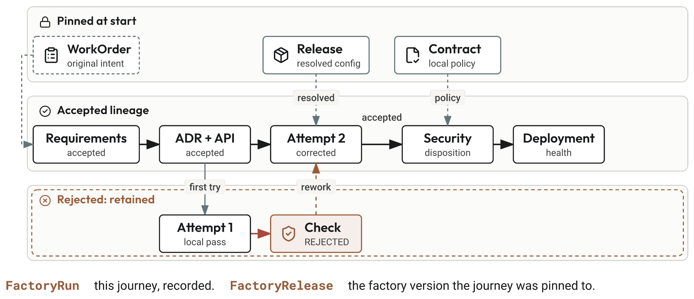

# evidence

Real artifacts from live factory runs. Every file was written by Claude during an actual coordinator execution.

**Policy:** `evidence/runs/` contains only real execution evidence — no synthetic data, no fabricated approvals.

---

<picture>
  <source media="(prefers-color-scheme: dark)" srcset="../docs/diagrams/s31-evidence-trace-dark.png">
  
</picture>

---

## Directory structure

```
evidence/
└── runs/
    └── {run-id}/
        ├── {stage}/
        │   ├── {artifact-id}/
        │   │   └── artifact.json        ← manifest: model, tokens, SHA-256, producerStatus
        │   └── workspace/
        │       ├── work-order.json      ← context seeded before Claude ran
        │       └── *.md / *.yaml / *.json  ← files Claude produced
        └── ...
```

## On producerStatus: PRODUCED

Every `artifact.json` says `producerStatus: PRODUCED`. This is correct. `PRODUCED` is what the stage executor reports: "I wrote the output files." `ACCEPTED` is what the coordinator records in Port and PostgreSQL after accepting the output. Two separate facts from two separate systems — exactly what the FactoryRun design requires.

## On model assignments

Each stage uses the model from `factory-releases/1.4.0/factory-release.yaml`. The result is a mix: sonnet for requirements and security, opus for architecture and engineering, haiku for operations.

## Reference run: `64e3fe0a-…`

All five stage workspaces present with real Claude-produced documents.

| Stage | Model | Key output files |
|-------|-------|-----------------|
| product-requirements | claude-sonnet-5-5 | product-spec.md, acceptance.yaml, work-items.json |
| software-architecture | claude-opus-5-5 | architecture.md, openapi-delta.yaml, adr.md |
| software-engineering | claude-opus-5-5 | implementation-notes.md, pr-description.md |
| security-compliance | claude-sonnet-5-5 | security-review.md, compliance-checklist.md |
| platform-operations | claude-haiku-5-5 | deployment.json, health-evidence.json, runbook.md |

## On execution

The coordinator in this reference implementation runs locally. GitHub Actions (`factory-run.yml`) creates the work order record and Port entity — it does not run the coordinator. For production, deploy the coordinator as a persistent service.

## Verifying integrity

```bash
pnpm factory evidence:verify --run-id 64e3fe0a-0bbc-4e2a-bbef-accebe598748
```

## Populating Port entity cost data

```bash
export PORT_CLIENT_ID=... PORT_CLIENT_SECRET=...
python3 scripts/backfill-port-runs.py
```

Reads artifact files, computes per-stage token costs at coordinator pricing, updates Port entities. Idempotent.
