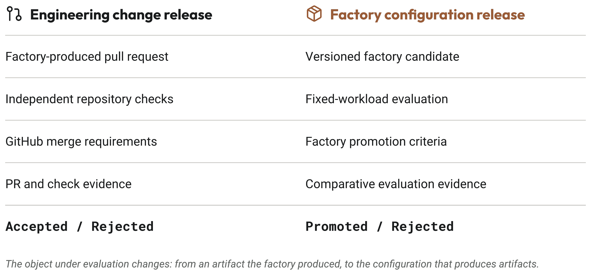
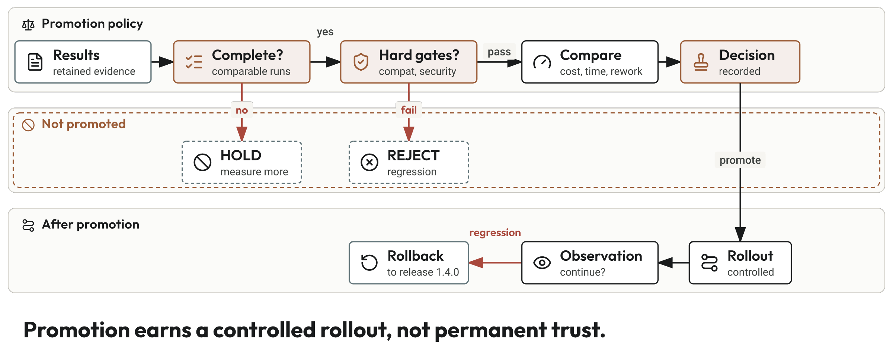

# factory-releases

Versioned factory configurations. Each release pins the models, skills, sandbox image, and workflow definition.

→ [Root README](../README.md#factory-release-model-assignments) · [docs/models.md](../docs/models.md)

---

<picture>
  <source media="(prefers-color-scheme: dark)" srcset="../docs/diagrams/s39-two-release-decisions-dark.png">
  
</picture>

---

## Structure

```
factory-releases/
  1.4.0/factory-release.yaml   ← ACTIVE baseline release
  1.5.0/factory-release.yaml   ← CANDIDATE (arch + eng use claude-fable-5-2)
  active.yaml                  ← Protected pointer to the active release
  skills.lock.json             ← SHA-256 digests for all 15 skills
  tools.lock.json              ← MCP endpoint identities and approved tool names
  sandbox.lock.json            ← Sandbox image configHash
```

## Active release: 1.4.0

| Stage | Model | Rationale |
|-------|-------|-----------|
| product-requirements | `claude-sonnet-5-5` | Requirements: creative + structured |
| software-architecture | `claude-opus-5-5` | ADRs + OpenAPI: deep reasoning |
| software-engineering | `claude-opus-5-5` | Code + tests: long-horizon |
| security-compliance | `claude-sonnet-5-5` | Policy matching: fast + structured |
| platform-operations | `claude-haiku-5-5` | Health checks: fast + cheap |

Pricing: opus $15/$75 · sonnet $3/$15 · haiku $0.25/$1.25 per million tokens.
Typical cost per 5-stage run: ~$2.10.

## Candidate release: 1.5.0

Overrides only two stages to `claude-fable-5-2`. All others fall back to `defaultModel: claude-opus-5-5`.

## `active.yaml` is protected

Do not edit `active.yaml` directly. Update only via:

```bash
pnpm factory promote --candidate 1.5.0 --decision <PromotionDecision-id>
```

Any direct edit without a `PromotionDecision` is a policy violation.

## Promotion policy

<picture>
  <source media="(prefers-color-scheme: dark)" srcset="../docs/diagrams/s42-promotion-policy-dark.png">
  
</picture>

A candidate that passes evaluation has earned eligibility for controlled deployment. It has not proved that every future factory run will be correct.

## Adding a new release

```bash
cp -r 1.4.0 1.6.0
# Edit 1.6.0/factory-release.yaml: bump version, status → CANDIDATE, update models
pnpm lock-components
pnpm factory evaluation:run --base 1.4.0 --candidate 1.6.0
```
