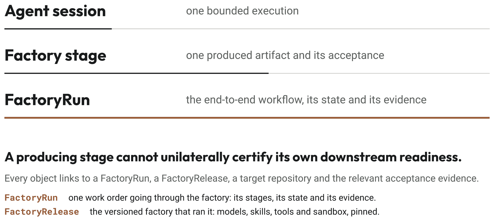

# packages

The factory runtime — independently testable TypeScript packages.

→ [Root README](../README.md#architecture)

---

<picture>
  <source media="(prefers-color-scheme: dark)" srcset="../docs/diagrams/s11-factoryrun-hierarchy-dark.png">
  
</picture>

---

## Packages

| Package | What it does |
|---------|-------------|
| `contract-types` | Shared TypeScript types: `FactoryRun`, `WorkOrder`, `FactoryRelease`, `FactoryStage`, `StageRecord` |
| `claude-executor` | Anthropic SDK agentic loop — loads AGENTS.md + SKILL.md, executes tool calls, returns produced files and token usage |
| `sandbox-adapter` | Creates isolated workspaces — local temp dirs (dev) or OpenSandbox API (CI/hardened) |
| `state-machine` | PostgreSQL-backed stage transitions with lease management to prevent duplicate execution |
| `port-client` | Port API client — upserts entities, reads WorkOrders, reports action run status |
| `github-client` | GitHub App client — file reads, PR creation, changed file lists via `kit.request()` |
| `artifact-store` | Collects workspace files into SHA-256 evidence bundles |
| `acceptance-client` | Waits for a `factory-contract/acceptance` GitHub check run to complete |

## Key design decisions

- `claude-executor` requires `report_stage_output` as the final tool call — Claude cannot finish a stage without declaring what it produced
- `state-machine` uses PostgreSQL leases to prevent two workers processing the same stage simultaneously
- `github-client` uses `kit.request()` throughout — `@octokit/app` installation kits lack REST namespace plugins
- `port-client` unwraps `result.entity ?? result` on single-entity GET responses

## What you bring

Nothing. These packages are the shared factory runtime. Domain-specific logic lives in `factories/` (AGENTS.md, SKILL.md) and `.factory/` in your consumer repos.
